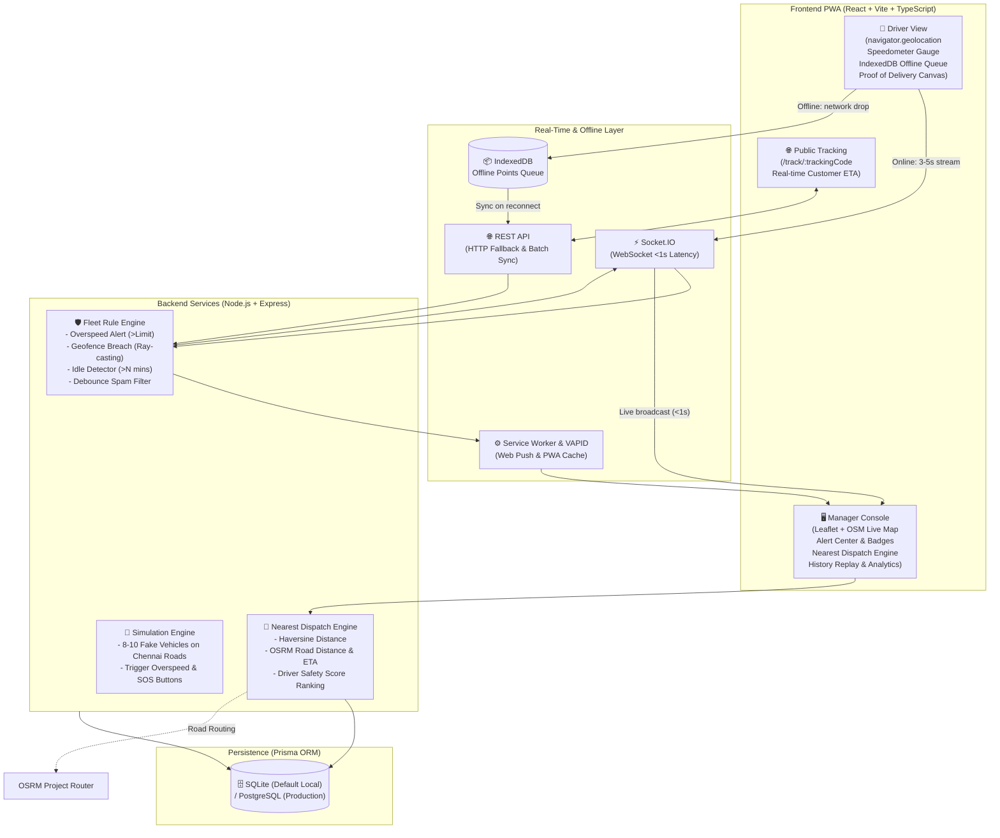

# FleetSync 🚚
### Mobile Fleet Tracking and Intelligent Vehicle Coordination System
> **Course Project:** ITA0316 Mobile Computing  
> **Architecture:** Progressive Web App (PWA) with Mobile-First Driver Console, Leaflet Maps, Real-Time Socket.IO, Server-Side Rule Engine & Offline Sync.

---

## 1. Product Summary

**FleetSync** is a mobile-first fleet tracking and vehicle coordination platform that eliminates expensive, specialized OBD-II or black-box tracking hardware and costly SMS gateways. By leveraging standard smartphones, modern Web APIs (`navigator.geolocation.watchPosition`, IndexedDB, Web Push, Service Workers), and WebSocket streaming, FleetSync provides end-to-end fleet tracking and dispatch:

- **Drivers** share high-frequency live GPS location, speed, and heading from their mobile browser with an adaptive battery-aware interval, offline queueing in IndexedDB, and digital Proof of Delivery (signature canvas & photo capture).
- **Fleet Managers** monitor all vehicles simultaneously on an interactive Leaflet/OpenStreetMap map, receive instant multi-channel push alerts for rule breaches (overspeed, geofence exit/entry, idle timeout, SOS), and dispatch trips to the nearest optimal vehicle using a combined Haversine + OSRM road distance ranking algorithm.
- **Customers** track their delivery in real-time via a lightweight, shareable public tracking link without requiring any login.

---

## 2. System Architecture



---

## 3. Tech Stack

| Component | Technology | Rationale |
| :--- | :--- | :--- |
| **Frontend** | React 18, Vite, TypeScript, Tailwind CSS | High-performance, reactive, typed mobile UI |
| **Icons & Charts**| Lucide React, Recharts | Accessible SVG icons & fleet analytics visualization |
| **Mapping Engine**| Leaflet + OpenStreetMap (OSM) | 100% Free, zero API key required, swappable tiles |
| **Real-Time Stream**| Socket.IO (WebSocket + Polling) | Sub-second latency live vehicle coordinate updates |
| **Backend API** | Node.js, Express, TypeScript | Modular REST controllers, Zod validation, JWT security |
| **Database & ORM** | SQLite (Default demo) / PostgreSQL, Prisma | Zero-config local setup, type-safe queries, migration-ready |
| **Offline Storage** | IndexedDB (`idb` wrapper) | Queue location updates when phone loses mobile signal |
| **PWA Capabilities**| Service Worker, Web App Manifest, Web Push | Installable on iOS/Android home screens, native-like UX |
| **Containerization**| Docker & Docker Compose | Multi-container reproducible production deployment |
| **API Docs** | Swagger / OpenAPI 3.0 (`/api-docs`) | Interactive REST API explorer and testing |

---

## 4. Setup & Running the Project

### Prerequisites
- Node.js (v18+ recommended)
- `pnpm` (or `npm`)

### Option A: Local Development (Instant Zero-Config SQLite)

1. **Clone the repository:**
   ```bash
   cd c:\FleetSync
   ```

2. **Backend Setup (`/server`):**
   ```bash
   cd server
   pnpm install
   npx prisma generate
   npx prisma db push
   pnpm run seed
   pnpm run dev
   ```
   *The server starts on `http://localhost:5000` (API Docs at `http://localhost:5000/api-docs`).*

3. **Frontend Setup (`/client`):**
   Open a new terminal:
   ```bash
   cd client
   pnpm install
   pnpm run dev
   ```
   *The client starts on `http://localhost:5173`.*

### Option B: Docker Compose

Run the entire stack with Docker:
```bash
docker-compose up --build
```
- Frontend: `http://localhost:5173`
- Backend & Swagger: `http://localhost:5000/api-docs`

---

## 5. Seed Data & Demo Accounts

The database comes pre-seeded with vehicles operating along realistic metropolitan road corridors (Chennai Metro), active geofences, trips, and demo accounts:

| Role | Email | Password | Assigned Vehicle / Notes |
| :--- | :--- | :--- | :--- |
| **Fleet Manager** | `manager@demo.com` | `manager123` | Full access to Live Map, Alerts, Dispatch, Analytics, Geofences |
| **Driver 1 (Truck)** | `driver1@demo.com` | `driver123` | Tata Ultra Truck (`TN-01-AB-1234`), Active Electronics Delivery |
| **Driver 2 (Van)** | `driver2@demo.com` | `driver123` | Mahindra Bolero (`TN-02-CD-5678`), Completed Trip with Signature |
| **Driver 3 (Car)** | `driver3@demo.com` | `driver123` | Maruti Eeco Cargo (`TN-03-EF-9012`), Ready for Dispatch |
| **Driver 4 (Bike)** | `driver4@demo.com` | `driver123` | Hero Commercial Bike (`TN-04-GH-3456`) |

*Tip: The Login page includes one-click buttons to auto-populate any of these demo profiles.*

---

## 6. Presentation & Live Demo Script (Step-by-Step)

Follow this 5-minute walkthrough during your project demonstration for maximum marks:

### Step 1: Manager Live Map & Simulation Engine
1. Log in as `manager@demo.com` (`manager123`) or click **Manager Console** on the login screen.
2. In the top navigation bar, click the **"Simulate"** button:
   - This starts the background simulation engine, moving 8 commercial vehicles along real Chennai road corridors (OMR, Guindy, Airport, Koyambedu).
   - Watch vehicles transition through color-coded statuses (Moving = Green, Idle = Amber, Arrived = Blue, Offline = Grey).
   - Click on any vehicle marker to open the detailed card (Plate, driver, speed, battery, heading).
   - Toggle the **Map Provider** dropdown (Carto Light, Carto Dark, OSM Standard, Satellite).

### Step 2: Triggering Overspeed and Emergency SOS
1. With simulation active, click the **"Overspeed"** button in the header:
   - Vehicle speed spikes to 95 km/h (Limit: 50–60 km/h).
   - The server-side Rule Engine evaluates the condition, applies debouncing, and generates a warning/critical incident.
   - Navigate to the **Alert Center** (`/alerts`) to see the instant alert with sound and GPS coordinates.
2. Click the **"SOS"** button in the header:
   - Generates an immediate Critical SOS Breakdown Alert broadcasted across the fleet.
   - Click **Acknowledge** to verify dispatch response.

### Step 3: Nearest-Vehicle Dispatch & Live Rerouting
1. Navigate to **Trip Dispatch** (`/dispatch`).
2. Click **"+ Create Trip"**:
   - The system executes the ranking algorithm (`rankVehiclesForDispatch`), calculating proximity via Haversine and road distance via OSRM.
   - Vehicles are ranked by ETA and Driver Safety Score.
   - Click **"Dispatch"** on the #1 ranked vehicle to assign the trip with a single click.
3. On an in-progress trip, click **"Reroute"** to change destination on the fly.

### Step 4: Driver Smartphone View & Offline GPS Queueing
1. Click **"Driver Console"** in the sidebar (or log in as `driver1@demo.com`).
2. Notice the mobile-first driver UI:
   - Big Start / Stop Trip button, high-contrast circular digital speedometer gauge.
   - Speed limit compliance indicators.
   - Click **"Navigate"** to open turn-by-turn directions.
   - Click **"Chat Dispatch"** to send live messages to the fleet manager.
3. **Simulate Network Drop (Offline-First demonstration):**
   - In browser DevTools -> Network -> set to **Offline**.
   - Notice the connection pill switches to **"Offline"** and queues location points into IndexedDB.
   - Switch back to **Online**; watch points automatically batch-sync to the server via `/api/tracking/batch` with zero data loss!
4. Click **"Complete Delivery"** to demonstrate **Proof of Delivery (POD)**:
   - Draw a digital signature on the HTML5 canvas pad.
   - Attach a proof photo and click Complete Trip.

### Step 5: Route History Replay & Fleet Analytics
1. Navigate to **History Replay** (`/history`):
   - Select vehicle `TN-02-CD-5678`.
   - Use the timeline playback slider and Play/Pause button with 1x, 2x, 4x speed controls.
   - Observe the animated vehicle retracing the historical route with an interactive speed profile graph.
2. Navigate to **Analytics** (`/analytics`):
   - Review total fleet distance, idle time %, Recharts daily distance trends, and the Driver Safety Score Leaderboard (0–100 score).
   - Click **"View Safety Hotspots"** to inspect overspeed clusters.
3. Open a new incognito window and visit `http://localhost:5173/track/FS-TRIP-1001` to show the **Customer Public Tracking Portal** with live ETA and progress without requiring login.

---

## 7. Unit Tests

Unit tests verify the core mathematical and algorithmic engines:
```bash
cd server
pnpm test
```

**Test Suite Coverage:**
- `src/tests/ruleEngine.test.ts`:
  - Overspeed violation detection against configurable limits
  - Critical severity escalation (>20 km/h over limit)
  - Anti-spam alert debouncing window
  - Ray-casting circular and polygon geofence Entry and Exit state transitions
- `src/tests/dispatch.test.ts`:
  - Haversine great-circle distance accuracy
  - Road travel time estimation
  - Candidate vehicle proximity ranking & automatic offline vehicle filtering

---

## 8. Limitations & Discussion

*(Corresponding to the ITA0316 discussion slides)*

1. **GPS Signal Dependency & Urban Canyons:**
   - Smartphone GPS accuracy varies between 3m to 15m. In dense urban corridors with tall buildings, multipath reflection can cause artificial jumps. FleetSync addresses this by implementing an adaptive accuracy filter that discards any readings with horizontal dilution of precision (HDOP) / accuracy radius > 50m.
2. **Mobile Network Intermittency:**
   - Cellular signals drop in tunnels, basements, and rural highways. Rather than failing silently, FleetSync employs an offline-first architecture using browser IndexedDB storage to buffer location updates locally and automatically flush them to the server in batch once network connectivity is re-established.
3. **Battery Consumption Optimization:**
   - Continuous GPS polling rapidly exhausts smartphone batteries. FleetSync uses an adaptive tracking rate: polling decreases to longer intervals when the vehicle is stationary (idle), and increases to 3-second intervals when high-speed movement is detected.
4. **Rule Engine Sensitivity & Threshold Tuning:**
   - False positive alerts (e.g., brief GPS drift triggering a geofence breach) are prevented through a 60-second debounce cache and consecutive-point verification.

---

## 9. License

Developed for academic presentation in **ITA0316 Mobile Computing**.  
Licensed under the [MIT License](LICENSE).
